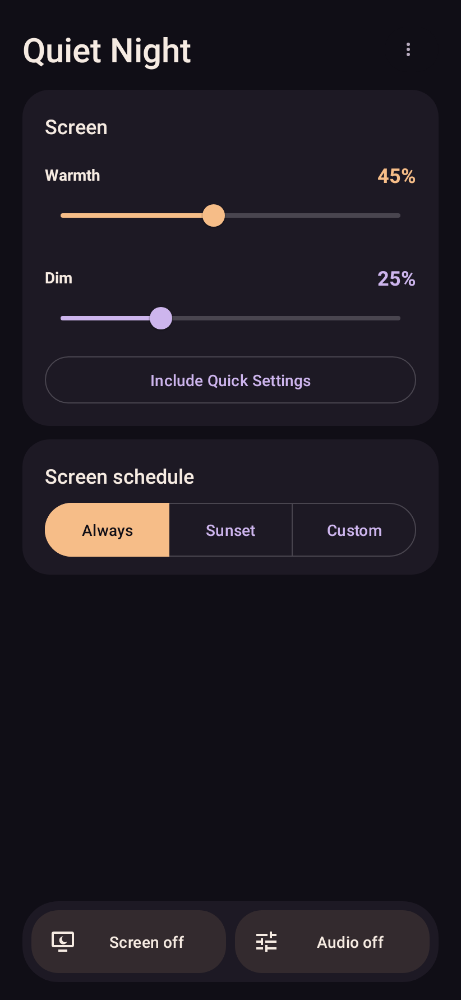
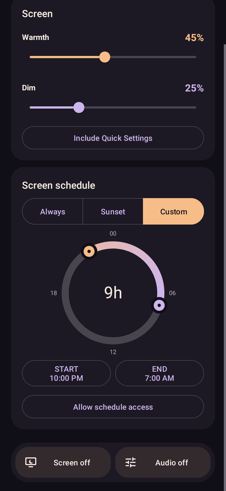
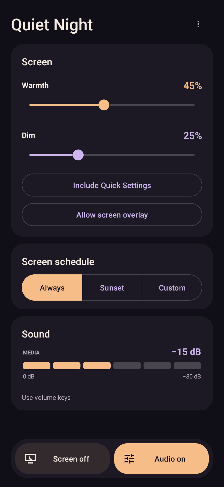

# Quiet Night

A private, open-source Android wind-down companion. Softer evening light, screen dimming, and media volume below Android’s usual minimum, together on one home screen.

Quiet Night is an independent GPL-3.0 fork of [Granular Volume / Quiet Dial](https://github.com/Rzuss/granular-volume) by Rzuss. It includes the Bluetooth audible-floor fixes developed in this fork. It is not an official upstream release.

<p>
  
  
  
</p>

## Your evening, in one place

A minimal Material home with wallpaper colors on supported devices. Help, privacy, and licenses live in the overflow menu; only controls and useful status appear on the main screen.

- **Themed app icon:** an adaptive moon-and-star icon follows the launcher’s shape and, on Android 13+ with themed icons enabled, its wallpaper palette. Quick Settings uses the same silhouette and toggles Screen only.
- **Warmth:** a fixed red-orange evening tint, adjustable from 0–100%.
- **Dim:** 0–85%, drawn as a touch-through evening overlay. It never changes your saved brightness or adaptive-brightness mode. Use **Include Quick Settings** to enable the accessibility screen filter, or allow display over other apps for app-only coverage.
- **Always:** keep the selected settings active until paused.
- **Sunset → sunrise:** calculate daily sun times offline from a saved location. Use optional foreground location access or enter coordinates manually. No background location tracking, geocoding, or internet access.
- **Custom:** drag either handle on the 24-hour circular slider, including overnight windows. Start and End buttons offer precise, accessible time entry.
- **Audio button:** independently enable the media-attenuation engine. A read-only Quiet Dial indicator shows media mute, normal volume, or the 0–30 dB quiet range; use the phone’s volume keys to change it. There is no attenuation slider.
- **Screen button:** independently activate screen tint/dimming or arm the selected screen schedule. Two independent toggles stay in a compact bottom bar.
- **Quiet steps with volume-down:** volume-down keeps stepping through the quiet range when hardware media volume reaches its audible floor. At −30 dB another press mutes media, and volume-up climbs back out. Cellular and VoIP call volume is not intercepted by this feature.
- **Bluetooth calibration:** find the first audible media-volume step on Android 13+. Preview controls are capped at four steps above the lowest nonzero index. Calibrations are saved by headset name; uncalibrated users keep the original path without media-route queries.
- A persistent notification with Stop, plus a screen-only Quick Settings tile. The tile never toggles audio. The notification Stop action stops both; either home button stops its own feature.

All features are free. No ads, accounts, analytics, purchase prompts, or internet permission. Screen dimming is an overlay, so your brightness setting and adaptive-brightness mode are left untouched. Bluetooth Absolute Volume is left unchanged. App backup is disabled so saved coordinates and settings are not uploaded through Android cloud backup.

## First run

1. Open Quiet Night and choose your preferred color intensity and dim level.
2. Use **Screen** and **Audio** in the bottom bar independently. For full-screen dimming, tap **Include Quick Settings**, then enable **Quiet Night screen dimming** in Android Accessibility settings. The service only draws a filter; it requests no screen-reading, gesture, or key-filtering capabilities. Display-over-other-apps access provides app-only coverage without the service. Audio works without screen permissions; notifications make Stop easier to reach.
3. For Custom or Sunset mode, grant **scheduled changes** access. This allows exact start/stop boundaries while the app is closed. Without this access, scheduled screen controls stay inactive and explain the missing setup instead of pretending to be armed. Always mode does not need it.
4. For Sunset, choose a location once. Update it manually when travelling. Sun times follow the phone’s current timezone; polar locations with no sunrise/sunset show a message and can use Custom instead.
5. Turn on **Audio**. If your headset is silent at the first nonzero step, play audio and open **Headphone setup** to calibrate the first audible step. For BX27 this can be step 2. Volume-down continues into the quiet range using the hardware buttons.

The schedule applies only to screen controls. Audio stays on until its own button is switched off, even during the daytime or without exact-alarm access. Screen changes do not recreate the running audio engine or overwrite Bluetooth calibration. The app never restores a previously high hardware volume automatically. Volume-up after mute returns a calibrated headset to its first audible step at the existing quiet gain.

## Light and sleep

The design favors dim red-orange light, which contains less short-wavelength light. [NIOSH explains the effect of light color on circadian rhythms](https://archive.cdc.gov/www_cdc_gov/niosh/emres/longhourstraining/color.html), and [NHLBI recommends avoiding bright artificial light before bed](https://www.nhlbi.nih.gov/health/sleep-deprivation/healthy-sleep-habits). The app does not claim a particular hue induces sleep or treats insomnia. Lower brightness and putting the phone away remain the goal.

## Android behavior and limits

- Android 9+; calibration uses the actual media-route query available on Android 13+.
- The accessibility filter covers notifications and Quick Settings; the ordinary application overlay is below these system windows. Protected screens and OEM restrictions can still hide filters. Always-on display, biometric illumination, HDR, and vendor-specific brightness overrides may behave differently.
- The dim percentage is an overlay amount, not a calibrated percentage of perceived luminance. The tint and dim layer remain touch-through so ordinary app input passes through.
- Audio effects and attenuation support vary by device, route, and player. Cellular-call audio cannot be attenuated through this engine. Verify your alarm and audio behavior on your own device; the app does not change the alarm-volume setting.
- Volume-down uses Android’s media-volume change broadcasts. A key press that produces no index change produces no broadcast; this is not a replacement for Android’s entire volume-key system.
- Sunset/sunrise calculations are an offline approximation including standard atmospheric refraction, not an astronomical instrument. Exact alarms still depend on Android permissions and the OS; force-stopping the app suppresses scheduled operation until it is opened again.
- The independent package is `dev.jaredtweed.quietnight` (`.debug` for test builds). It can coexist with upstream Quiet Dial. Do not run two audio-control services simultaneously. The old app’s private settings cannot be imported automatically across package IDs; calibrate the new app once.

## Build and test

JDK 17 and Android SDK 36 are required. No signing secrets are needed for debug builds.

```sh
cd android
./gradlew :app:assembleFdroidDebug :app:testFdroidDebugUnitTest
```

APK: `android/app/build/outputs/apk/fdroid/debug/app-fdroid-debug.apk`.

```sh
adb install -r android/app/build/outputs/apk/fdroid/debug/app-fdroid-debug.apk
```

Release builds use `:app:assembleFdroidRelease` and require your own signing process. Do not distribute debug keys as release keys. The retained `fdroid` build flavor contains only open-source runtime dependencies.

Upgrades retain **Modify system settings** solely to restore a pending brightness transaction from an older version. New installs never request this access, and overlay dimming never creates or applies a brightness transaction. Manual brightness changes take precedence over legacy recovery.

Regression tests cover legacy brightness recovery, full-range held-key mute/unmute sequences, trusted overlay composition, rendered home/schedule screens, the existing Bluetooth fixes, capped calibration, the uncalibrated fast path, volume-down and mute behavior, overnight and daytime schedules, DST, solar date wrapping, polar-day fallback, permission gating, alarm scheduling, and the touch-through overlay’s window configuration. CI builds debug and optimized release APKs, runs lint, and executes the regression suite.

## Credits and license

GPL-3.0-only; see [LICENSE](LICENSE). Granular Volume’s audio engine and original work are by Rzuss and its contributors. Quiet Night’s home, screen controls, schedules, and fork extensions are by Jared Tweed and contributors. Runtime third-party notices are available inside the app under **Licenses**. Historical upstream store assets and documentation are retained as source history; they do not describe this fork’s distribution or privacy policy.
